# Diagrammer Native Layout Engines

> **First-party, zero-dependency, pure Rust vector layout engines compiled to native CLI and WebAssembly.**

Historically, Diagrammer relied on external CLI tools (`dot`, `mscgen`, `plantuml.jar`, `blockdiag`) or client-side JavaScript libraries (`d3`, `mermaid.js`, `gojs`). The Native Layout Engine project introduces **5 core topological layout archetypes** written in 100% Rust (`crates/diagrammer-core/src/layout/`), capable of rendering publication-grade, theme-adaptive vector SVG and PNG output with zero external dependencies.

---

## 1. Architecture: The 5 Topological Archetypes

Rather than creating $N \times M$ separate layout engines, Diagrammer organizes layout around **5 fundamental topological archetypes**. Visualizer declarations (`visualizer <hint>`) serve as polymorphic presentation and styling subtype hints passed directly into the archetype engine.

```
┌────────────────────────────────────────────────────────────────────────┐
│                        DIAGRAMMER AST CANVAS                           │
└──────────────────────────────────┬─────────────────────────────────────┘
                                   │
         ┌───────────────┬─────────┴───────┬──────────────┬──────────────┐
         ▼               ▼                 ▼              ▼              ▼
   1. LAYERED       2. SEQUENCE       3. TREE /      4. 2D BLOCK    5. FORCE /
      DAG              TIMELINE          DENDROGRAM     GRID / BUS     PHYSICS
   (Sugiyama)      (Monotonic 1D)     (Branching)    (Manhattan)    (Springs)
         │               │                 │              │              │
    [Sub-hints]     [Sub-hints]       [Sub-hints]    [Sub-hints]    [Sub-hints]
    • uml           • sequence        • tree         • grid         • force
    • flowchart     • timing          • dendrogram   • network_bus  • organic
    • network       • phases          • mindmap      • block        • physics
    • er            • msc             • fan          • rack         • cluster
```

| # | Archetype | Module Path | CLI Commands / Visualizer Hints | Mathematical Foundation | Key Presentation Features |
|:---:|:---|:---|:---|:---|:---|
| **1** | **Layered DAG** | `layout/layered/` | `layered`, `dag`, `uml`, `flowchart` | Longest-path Sugiyama ranking, barycenter crossing reduction, channel routing | Port distribution on perimeters, multi-track channels (14px lanes), UML class cards, hollow inheritance arrows |
| **2** | **Native Sequence** | `layout/sequence.rs` | `native_sequence`, `sequence`, `msc` | Monotonic 1D participants $\times$ sequential chronological progression | Execution activations, dashed frames (`loop`, `alt`, `opt`), self-loops, delay gaps (`...`), anchored note callouts |
| **3** | **Tree & Dendrogram** | `layout/tree.rs` | `tree`, `radial`, `dendrogram`, `fan` | Rooted parent-child spanning trees, DFS subtree width calculation | Centered parents with cubic Béziers (Tidy Tree); radial angle/radius coordinate projection (Radial Fan) |
| **4** | **2D Block Grid** | `layout/grid.rs` | `grid`, `block`, `network_bus`, `rack` | Manhattan cell matrix and multi-drop highway buses | Container highway bus rails with vertical dashed drop taps, IP address badges, discrete grid snapping |
| **5** | **Force Physics** | `layout/force.rs` | `force`, `organic`, `physics` | Fruchterman-Reingold spring-electrical simulation ($\sim 2\text{ms}$) | Coulomb repulsive anti-gravity, Hooke spring attraction, simulated annealing cooling, soft boundary containment |

---

## 2. CLI & Web Usage

### Native CLI Rendering
The native CLI binary (`./diagrammer`) compiles with full layout engine support:
```bash
# Render to vector SVG
./diagrammer layered tests/test_inputs/ast.txt -o out.svg
./diagrammer sequence tests/test_inputs/native_sequence.txt -o out.svg
./diagrammer tree tests/test_inputs/tree_dendrogram.txt -o out.svg
./diagrammer radial tests/test_inputs/tree_dendrogram.txt -o out.svg
./diagrammer grid tests/test_inputs/network_bus.txt -o out.svg
./diagrammer force tests/test_inputs/force_network.txt -o out.svg

# Render directly to high-resolution PNG (auto-rasterized via rsvg-convert)
./diagrammer layered tests/test_inputs/ast.txt -o out.png
./diagrammer sequence tests/test_inputs/events.txt -o out.png
./diagrammer force tests/test_inputs/force_network.txt -o out.png

# Pipe diagram source via stdin
echo 'a > (b, c) > d' | ./diagrammer layered -o pipeline.png
```

### Browser WebAssembly (Zero Build / Zero CLI)
All 5 layout engines compile into the WebAssembly package (`build/wasm/`). In the Web UI:
1. Select **Generator Family**: `Diagrammer Native`.
2. Select **Visualizer**:
   - `Diagrammer: Native Sequence [WASM]`
   - `Diagrammer: Layered DAG [WASM]`
   - `Diagrammer: Tree / Dendrogram [WASM]`
   - `Diagrammer: 2D Grid / Network Bus [WASM]`
   - `Diagrammer: Force-Directed Physics [WASM]`

---

## 3. Visual Verification Gallery (25 Examples)

### Archetype 1: Hierarchical Layered DAG (`layered`)

#### 1.1 UML AST Object Model (`ast.txt`)
Demonstrates perimeter port distribution and 4 non-overlapping horizontal tracks in the inter-rank channel:
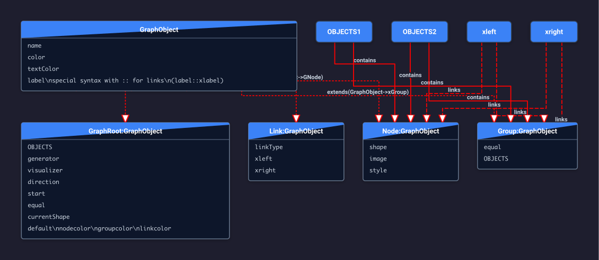

#### 1.2 UML Class Inheritance & Members (`umlclass.txt`)
Structured class compartments, attribute lists, and hollow inheritance arrows (`<|--`):
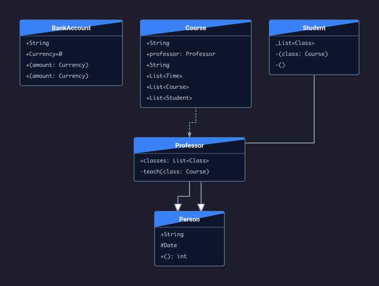

#### 1.3 Multi-Entrance & Multi-Exit Subgraphs (`subgraph_linking.txt`)
Auto-linking from preceding entrances through container members to succeeding exits:
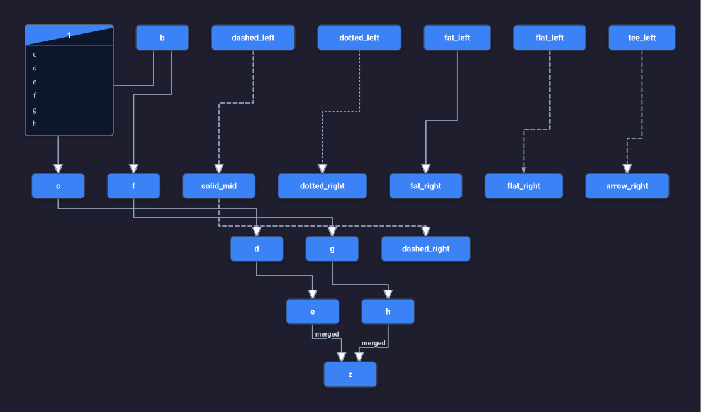

#### 1.4 CI/CD Build & Deployment Pipeline
Branching verification stages with topological ranking:
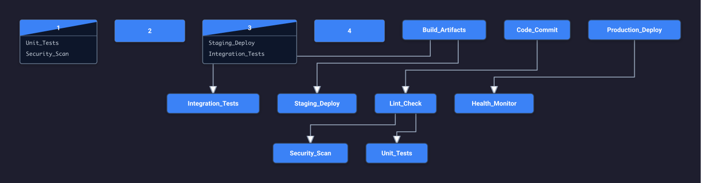

```diagrammer
visualizer layered
theme { background: "#1e1e2e" vertex-color: "#3b82f6" edge-color: "#94a3b8" }
Code_Commit > Lint_Check > (Unit_Tests, Security_Scan)
(Unit_Tests, Security_Scan) > Build_Artifacts
Build_Artifacts > (Staging_Deploy, Integration_Tests)
(Staging_Deploy, Integration_Tests) > Production_Deploy > Health_Monitor
```

#### 1.5 E-Commerce Microservices Architecture
Fan-out from API gateway through domain services into database clusters:
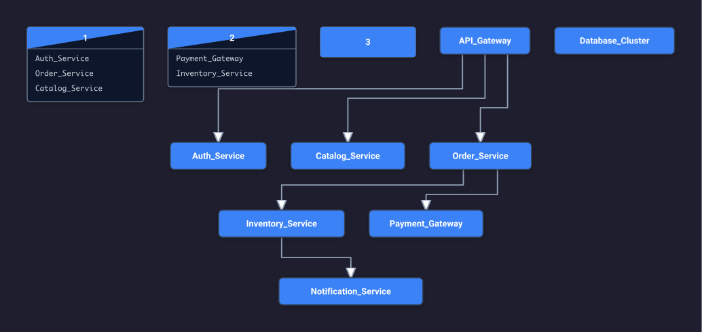

```diagrammer
visualizer layered
API_Gateway > (Auth_Service, Order_Service, Catalog_Service)
Order_Service > (Payment_Gateway, Inventory_Service)
Inventory_Service > Notification_Service
(Auth_Service, Order_Service, Catalog_Service) > Database_Cluster
```

---

### Archetype 2: Native Monotonic Sequence (`sequence`)

#### 2.1 Lifeline Activations, Frames & Notes (`native_sequence.txt`)
Lifeline execution activations (`[` and `]`), dashed frames (`loop`), delay gaps (`...`), and anchored notes:
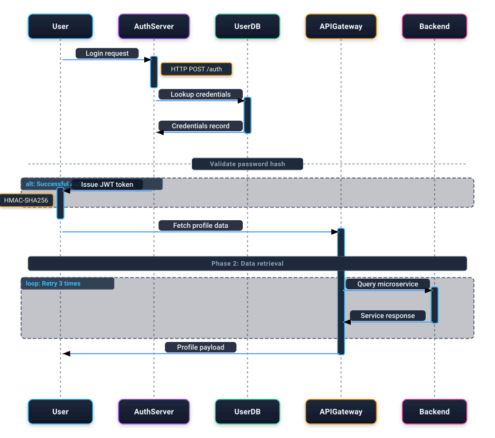

#### 2.2 Client-Server Event Protocol (`events.txt`)
High-density chronological message protocol across distributed tiers:
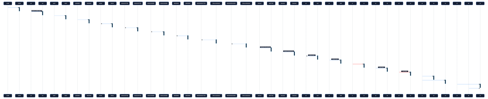

#### 2.3 Authentication & Handshake Flow (`state_sequence.txt`)
State-driven message choreography with self-loops and return paths:
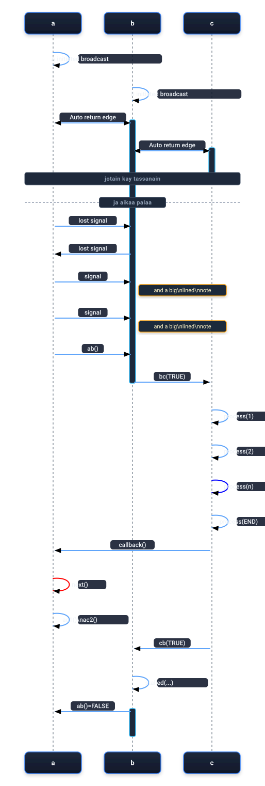

#### 2.4 SIP VoIP Telephony Call Setup (`state_sip_sequence.txt`)
Standard SIP call establishment protocol (Invite, 180 Ringing, 200 OK, Ack, RTP Audio, Bye):
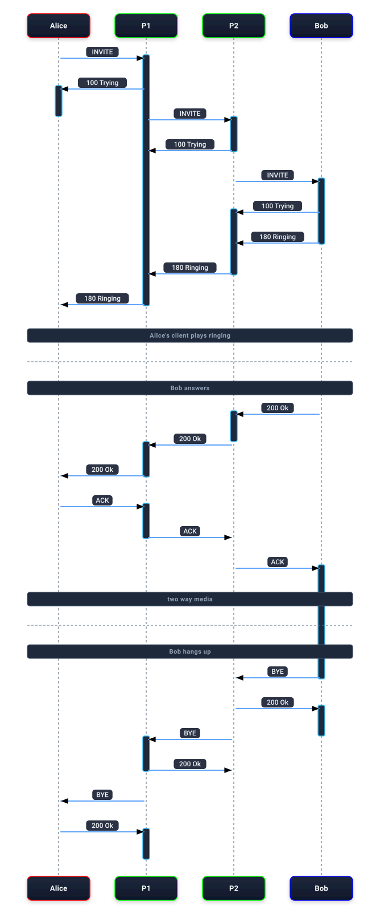

#### 2.5 OAuth2 PKCE Authorization Exchange
Sequential authorization and token issuance protocol:
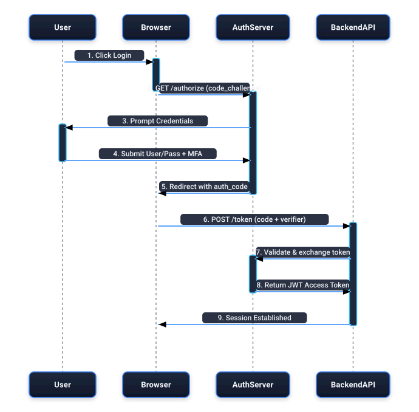

```diagrammer
visualizer sequence
User > Browser;1. Click Login
Browser > AuthServer;2. GET /authorize (code_challenge)
AuthServer > User;3. Prompt Credentials
User > AuthServer;4. Submit User/Pass + MFA
AuthServer > Browser;5. Redirect with auth_code
Browser > BackendAPI;6. POST /token (code + verifier)
BackendAPI > AuthServer;7. Validate & exchange token
AuthServer > BackendAPI;8. Return JWT Access Token
BackendAPI > Browser;9. Session Established
```

---

### Archetype 3: Hierarchical Tree & Radial Dendrogram (`tree` / `radial`)

#### 3.1 Tidy Reingold-Tilford Subtree Layout (`tree_dendrogram.txt`)
Bottom-up subtree width calculation, centered parents, and smooth cubic Bézier connectors:
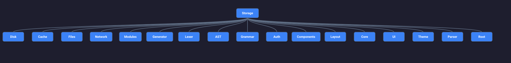

#### 3.2 Radial Circular Fan Projection (`tree_dendrogram.txt`)
The exact same graph projected radially around a central root with radial Bézier arcs:
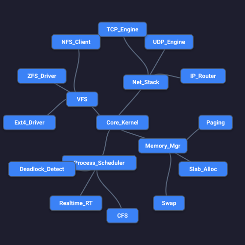

#### 3.3 Executive Engineering Org Hierarchy
Corporate reporting structure with balanced department fan-out:
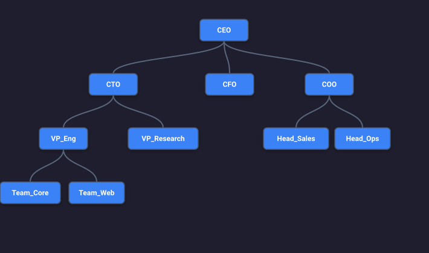

```diagrammer
visualizer tree
CEO > (CTO, CPO, CRO)
CTO > (VP_Infrastructure, VP_Application, VP_Security)
VP_Infrastructure > (Cloud_Ops, Site_Reliability, Database_Admins)
VP_Application > (Frontend_Lead, Backend_Lead, Mobile_Lead)
Frontend_Lead > (Web_Core, Design_System)
Backend_Lead > (API_Platform, Data_Pipeline)
```

#### 3.4 Unix File System Directory Tree
Hierarchical filesystem root (`/`) branching into system subdirectories:
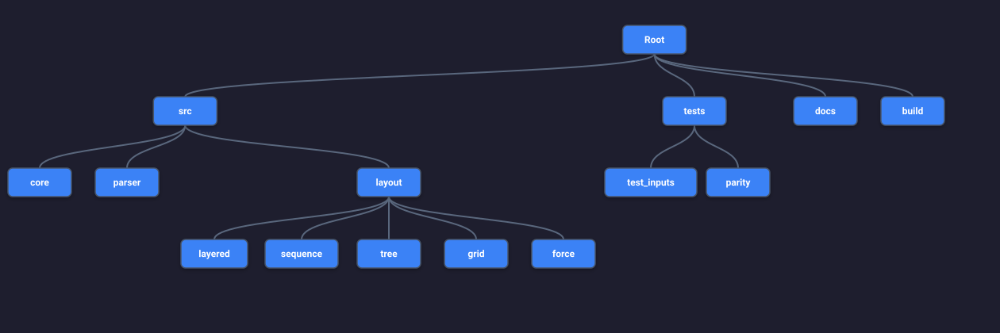

```diagrammer
visualizer tree
root > (bin, etc, usr, var, opt)
usr > (bin_usr, lib, local, share)
local > (bin_local, etc_local, include)
var > (log, run, spool, tmp)
```

#### 3.5 Compiler Arithmetic Expression AST
Binary expression tree for syntax analysis and operator precedence:
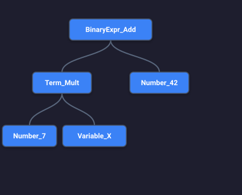

```diagrammer
visualizer tree
Add_Op > (Mul_Left, Div_Right)
Mul_Left > (Var_A, Var_B)
Div_Right > (Sub_Inner, Const_42)
Sub_Inner > (Var_X, Const_10)
```

---

### Archetype 4: 2D Block Grid & Network Bus (`grid`)

#### 4.1 DMZ & Internal LAN Highway Buses (`network_bus.txt`)
Container groups convert automatically into horizontal 4px bus rails with dashed drop taps and IP addresses:
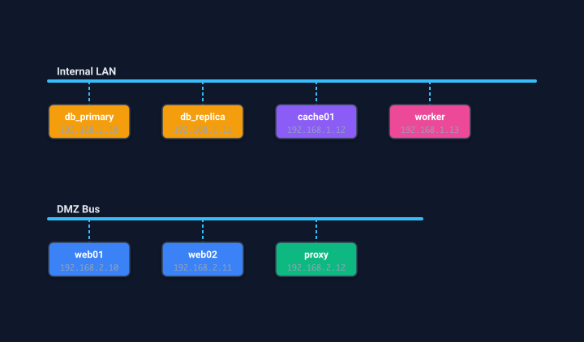

#### 4.2 AWS Multi-Tier VPC Network Rails
Public, Application, and Database subnet highway rails with isolated subnet tiers:
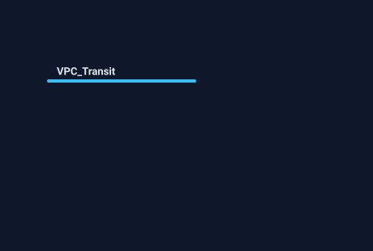

```diagrammer
visualizer grid
{ "Public Subnet (10.0.1.0/24)"
  NAT_Gateway#3b82f6
  Bastion_Host#3b82f6
  Alb_Ingress#10b981
}

{ "Application Subnet (10.0.2.0/24)"
  App_Pod_01#8b5cf6
  App_Pod_02#8b5cf6
  App_Pod_03#8b5cf6
}

{ "Secure Data Subnet (10.0.3.0/24)"
  Postgres_Primary#f59e0b
  Postgres_ReadReplica#f59e0b
  Redis_Cluster#ec4899
}
```

#### 4.3 Data Center Rack Blade Servers
Top-of-Rack high-speed switch rail distributing connectivity to blade compute units:


```diagrammer
visualizer grid
{ "Top-of-Rack 100G Switch"
  Blade_Compute_01#0284c7
  Blade_Compute_02#0284c7
  Blade_Compute_03#0284c7
  Blade_Compute_04#0284c7
  Storage_SAN_01#ea580c
  Storage_SAN_02#ea580c
}
```

#### 4.4 Industrial Modbus/CAN Fieldbus
Industrial fieldbus channels connecting sensors, controllers, and valves:


```diagrammer
visualizer grid
{ "CAN Fieldbus Channel A"
  Thermal_Sensor_01#14b8a6
  Pressure_Gauge_02#14b8a6
  Flow_Meter_03#14b8a6
  Emergency_Valve#ef4444
}

{ "RS-485 Modbus Telemetry"
  Telemetry_Unit#6366f1
  PLC_Controller#6366f1
  HMI_Touchscreen#6366f1
}
```

#### 4.5 2D Component Matrix Grid
Discrete Manhattan matrix grid layout for unstructured blocks:


```diagrammer
visualizer grid
Alpha > Beta > Gamma
Beta > Delta
Delta > Epsilon > Zeta
Gamma > Eta > Theta
```

---

### Archetype 5: Force-Directed Physics Simulation (`force`)

#### 5.1 Hub & Spoke Ring Network (`force_network.txt`)
Central hub connected to a perimeter cycle; forces balance into a symmetric circular equilibrium:
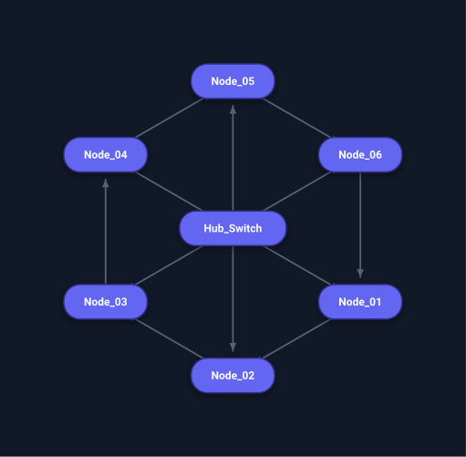

#### 5.2 High-Density Social Friendship Mesh
Interconnected social cliques naturally clustered by mutual edge attraction:
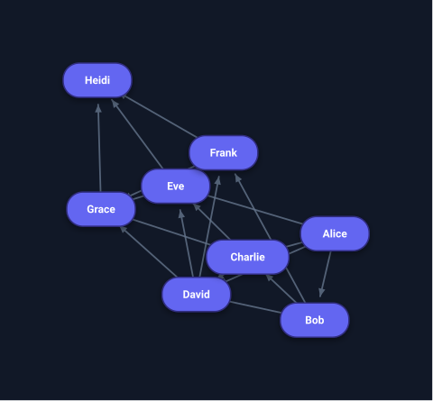

```diagrammer
visualizer force
Alice > Bob, Charlie, David, Eve
Bob > Charlie, David, Frank
Charlie > David, Eve, Grace
David > Eve, Frank, Grace
Eve > Frank, Grace, Heidi
Frank > Grace, Heidi
Grace > Heidi
```

#### 5.3 Bipartite User-Role Access Graph
Roles attract users with shared permissions into grouped partitions:
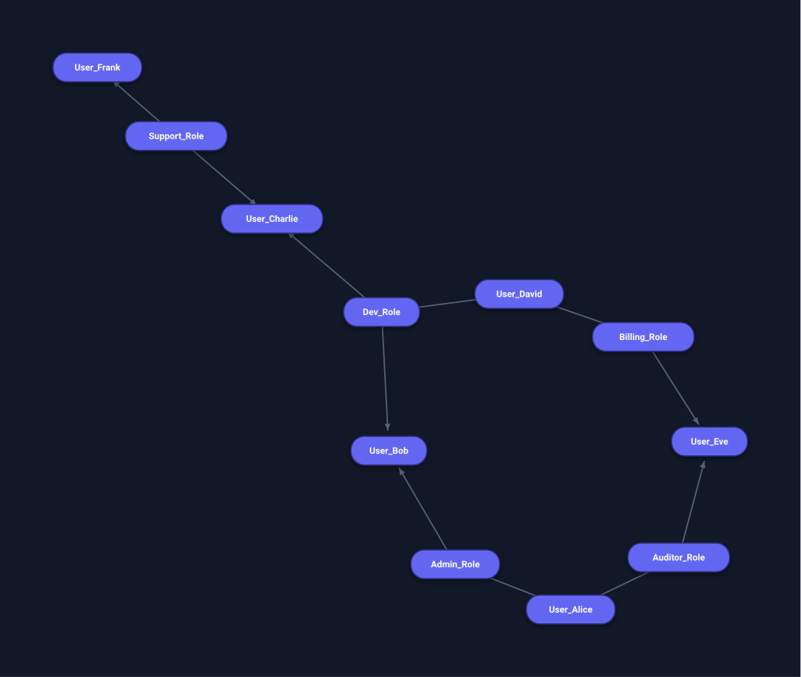

```diagrammer
visualizer force
Admin_Role > User_Alice, User_Bob
Dev_Role > User_Bob, User_Charlie, User_David
Auditor_Role > User_Eve, User_Alice
Billing_Role > User_David, User_Eve
Support_Role > User_Charlie, User_Frank
```

#### 5.4 Dual-Clique Cluster Bridge
Two tightly connected complete subgraphs held apart by Coulomb repulsion and linked by a central bridge:


```diagrammer
visualizer force
ClusterA_1 > ClusterA_2 > ClusterA_3 > ClusterA_1
ClusterA_2 > ClusterA_4 > ClusterA_1
Bridge_Gateway > ClusterA_4, ClusterB_1
ClusterB_1 > ClusterB_2 > ClusterB_3 > ClusterB_1
ClusterB_2 > ClusterB_4 > ClusterB_1
```

#### 5.5 Deep Neural Network Interconnections
Input, hidden, and output layers organized dynamically by spring-electrical tensions:
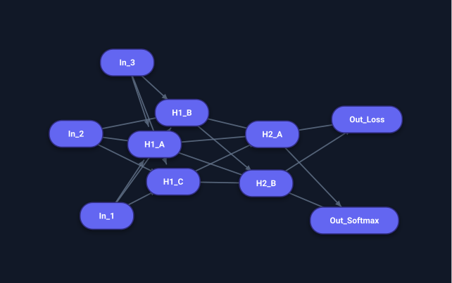

```diagrammer
visualizer force
In_1 > H1_A, H1_B, H1_C
In_2 > H1_A, H1_B, H1_C
In_3 > H1_A, H1_B, H1_C
H1_A > H2_A, H2_B
H1_B > H2_A, H2_B
H1_C > H2_A, H2_B
H2_A > Out_Softmax, Out_Loss
H2_B > Out_Softmax, Out_Loss
```

---

## 4. Test Harness & Regression Suite

Diagrammer maintains a native Rust integration test suite in [`crates/diagrammer-core/tests/native_layout_engines.rs`](../crates/diagrammer-core/tests/native_layout_engines.rs):
```bash
cargo test --test native_layout_engines
```
- Validates SVG output structure, viewBox dimensions, CSS classes, and NaN coordinates across all 5 engines in **0.02 seconds**.
- Tests CLI output rasterization and file pipeline integrity.

